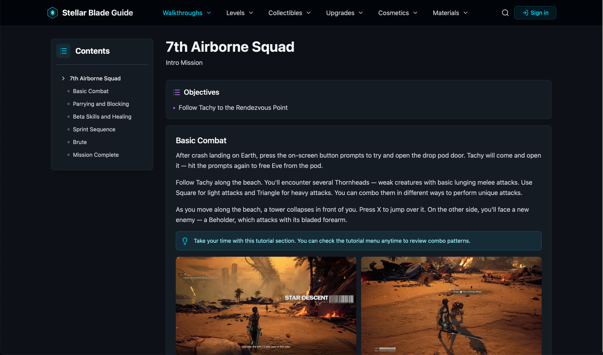
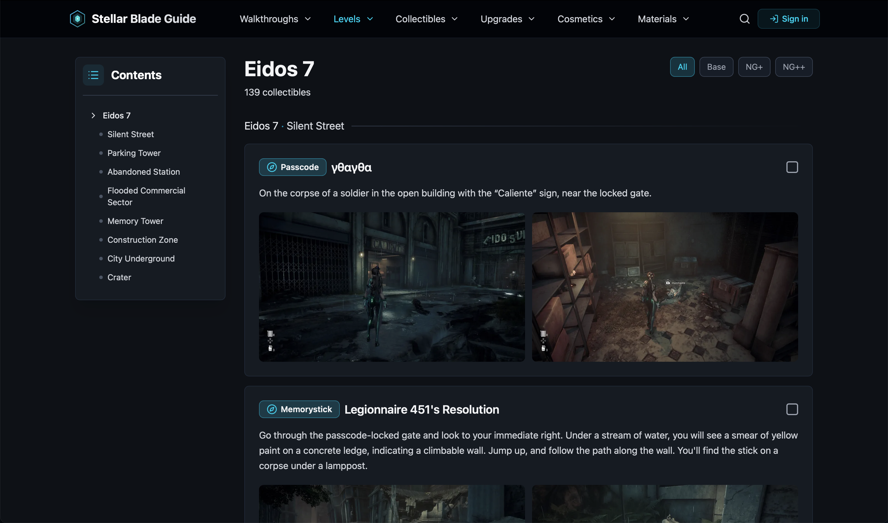
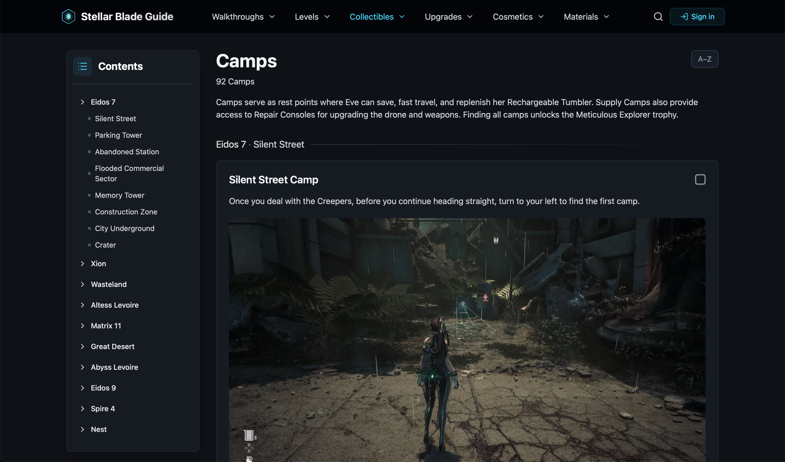

# Stellar Blade Guide

An unofficial game guide for *Stellar Blade*: 1,078 collectibles across 21 types and 95 walkthrough pages (main story, side quests, Bulletin Board requests, the NieR and NIKKE DLC, and fishing), with written directions and a screenshot for every collectible. Full-stack web application with 2,800+ original PS5 screenshots served as pre-generated WebP from Cloudflare R2.

**[Live Site](https://stellarbladeguide.com)** | **Tech Stack:** TypeScript, React, Python, FastAPI, PostgreSQL, Redis

**Key Features:** Progress tracking (guest + authenticated) • Walkthroughs • Full-text search • User authentication • OAuth (Google/Discord) • Threaded comments • AI content moderation • Cloudflare edge and Redis caching • Cloudflare R2 image CDN • Image galleries • Responsive design


<details>
<summary><b>Built With</b></summary>

### Frontend
[](https://www.typescriptlang.org/)
[](https://react.dev/)
[](https://tailwindcss.com/)
[](https://tanstack.com/query/latest/docs/framework/react/installation)

### Backend
[](https://www.python.org/)
[](https://fastapi.tiangolo.com/)
[](https://www.sqlalchemy.org/)
[](https://pydantic.dev/docs/)

### Database
[](https://www.postgresql.org/)
[](https://redis.io/)

</details>

## Table of Contents
- [Technical Details](#technical-details)
- [Repository Layout](#repository-layout)
- [Screenshots](#screenshots)
- [Installation](#installation)
- [Use and attribution](#use-and-attribution)

## Technical Details

**Frontend**
- React 19 with TypeScript
- TanStack Query for data fetching, caching, and prefetching on hover
- Tailwind CSS for styling
- Image lightbox with zoom capability
- Skeleton loaders and smooth loading states
- Responsive design with mobile navigation drawer
- Protected routes with auth guards
- Progress tracking with localStorage for guests and API persistence for authenticated users
- A Progress page for authenticated users, with completion by level, type, and cycle, and bulk actions that clear or mark found a whole level, type, or cycle after a preview counts the change
- Optimistic progress checkmarks with automatic rollback on failure

**Backend**
- FastAPI with async endpoints
- JWT authentication with short-lived access tokens (15 min) held in memory and rotating refresh tokens (7 days) in HttpOnly cookies
- OAuth 2.0 integration with Google and Discord
- Password reset flow via email (Resend)
- SQLAlchemy ORM with async support
- Pydantic for request/response validation
- Role-based access control (user, moderator, admin)
- Rate limiting (slowapi, per route and client) and a bot-filter middleware that answers probe paths (CMS and admin paths, file-shaped or overlong URLs) and off-site API referers with a 404
- AI-powered comment moderation via OpenAI Moderation API
- Progress tracking with guest-to-authenticated sync on login
- Production runs uvicorn with two workers, and FastAPI serves the built React SPA as a catch-all, with no separate static server
- FastAPI splices per-route head tags (title, description, canonical, Open Graph, Twitter card) into the built React shell, from the `seo.json` the client also imports and, for walkthroughs, from the database, so link previews and crawlers that don't run JavaScript get each page's own head without SSR

**Database**
- PostgreSQL with a relational schema: levels hold locations, and locations hold collectibles
- One junction table maps collectibles to types, since some items have two (a memorystick that is also a passcode)
- Soft deletes for comments to preserve thread context
- Indexes on the reads that skip the cache (progress, comments, notifications) and on lookup keys (email, username, slugs)

**Performance & Caching**
- Multi-tier caching: Cloudflare's edge (content API responses for up to 30 days, purged by URL when a content deploy changes them) + Redis (server-side, 30-day TTL) + ETag/304 responses + TanStack Query (client-side)
- Redis outages degrade gracefully: cached reads fail open to PostgreSQL, rate limiting falls back to in-memory counters, and auth endpoints fail closed with a 503 + Retry-After
- `no-store` on per-user and mutable routes (progress, auth, account, comments, notifications), so the edge never caches them
- Cloudflare R2 with edge caching for image delivery (pre-generated WebP variants, immutable cache headers)
- Every API response carries an X-Process-Time timing header

**Infrastructure**

Content images are pre-generated as static WebP variants (four srcSet widths plus a full-size WebP per image, six widths for the home hero, no runtime transforms) and served from Cloudflare R2 behind `img.stellarbladeguide.com` with immutable one-year cache headers and zone edge caching. Cloudinary hosts user avatars only. Pipeline details live in `server/scripts/images/PIPELINE.md`.

The app runs as one Docker service on Railway behind Cloudflare. The origin requires a secret header only Cloudflare adds, and PostgreSQL and Redis take no public connections.

Content is versioned JSON in its own repository, and a content deploy lands in one transaction per content type. It then purges from Cloudflare's cache only the API URLs that changed, or every API URL if anything is in doubt, and never images.

**Auth & User System**
- Email/password registration and login
- OAuth sign-in with Google and Discord (avatar pulled from provider)
- OAuth binds a single-use `state` to an HttpOnly cookie and a 10-minute Redis record against login CSRF, and links or creates an account only for a provider-verified email, never linking into an account with a password
- Refresh tokens rotate on every use, a superseded token reused after a 60-second grace ends its session, and a 90-day cap ends every session however often it refreshes
- Account settings: username, avatar from an image URL (fetched once, moderated by OpenAI, and re-hosted on Cloudinary), password change for password accounts, sign out of all devices, account deletion

**Comments**
- Threaded comments (one level of nesting) on walkthrough, level, and type pages
- Post, edit, and delete with ownership checks
- Moderator and admin controls
- AI moderation via OpenAI flags inappropriate content before it's saved
- Soft delete preserves thread context when a parent comment is removed

**Search**
- One ranked search across collectibles, walkthroughs and their text, and the type, walkthrough category, and level pages
- PostgreSQL stored `tsvector` columns, half-typed words, a few aliases (New Game Plus, outfits), `pg_trgm` similarity for misspelled titles, and a typo fallback
- Rate-limited to 30 req/min; results cached in Redis for 1 hour

**Testing**
- 1,899 pytest tests on in-memory SQLite and fakeredis, so they need no running services; 1,740 of them run in CI, since 159 need the private content repo
- 222 Vitest unit tests for the client's pure logic
- 192 Playwright end-to-end tests in 27 specs, run before merging against the real dev servers and a dev database loaded from the private content repo
- CI runs pytest, ESLint, Vitest, and the type-checking build on pushes to main and on pull requests

## Repository Layout

```
client/            React SPA (see client/README.md)
server/            FastAPI backend (see server/README.md)
server/seed-data/  JSON source data for all guide content, in its own private repository (conventions documented in server/README.md)
e2e/               Playwright end-to-end suite, run against the dev servers (npm run e2e:install once, then npm run e2e)
.devcontainer/     Docker Compose dev environment (app container + PostgreSQL + Redis)
.github/           CI workflow (pytest, ESLint, Vitest, type-checking build)
Dockerfile         multi-stage production build (Node builds the SPA, Python serves it)
package.json       root scripts that orchestrate client + server
```

Each app documents its own structure, commands, and internals: [client/README.md](client/README.md) and [server/README.md](server/README.md).

Publishing a content change, from editing the JSON to a production content deploy, follows the [content seeding runbook](server/scripts/content-seeding-runbook.md).

## Screenshots
<details>
<summary><b>View More Screenshots</b></summary>





</details>

## Installation

### Dev Container (recommended)

Requires [VS Code](https://code.visualstudio.com/), the [Dev Containers](https://marketplace.visualstudio.com/items?itemName=ms-vscode-remote.remote-containers) extension, and [Docker](https://www.docker.com/products/docker-desktop/).

1. Clone the repository and open the folder in VS Code
2. Click **Reopen in Container** when prompted, or press `F1` → *Dev Containers: Reopen in Container*
3. The container installs npm 11, Claude Code, and the server and client dependencies (`uv sync` in `server/`, `npm ci` in `client/`)
4. Run `npm install` in the repo root, which adds `concurrently` for `npm run dev`
5. Create `server/.env` (see **Environment Variables** below)
6. Create the schema and the levels, types, and locations: `cd server && uv run python scripts/db/seed_db.py`
7. Start both servers from the repo root:

```bash
npm run dev
```

Frontend: http://localhost:3000 · API: http://localhost:8000

PostgreSQL and Redis are provided by the container; no local installs needed. The collectibles and walkthroughs live in a separate private repository (`server/seed-data`), so a clone runs without them.

### Environment Variables

Create `server/.env` before starting the servers. The variable table, with each variable's purpose, lives in [server/README.md](server/README.md#environment-variables).

<details>
<summary>Manual setup (without Dev Container)</summary>

**Prerequisites:** Node.js 22.12+ with npm 11, Python 3.14 (pinned in `server/.python-version`; `uv sync` downloads it if it's missing), PostgreSQL 17 and Redis 8.4 (the versions dev and production run), [uv](https://github.com/astral-sh/uv)

From the repo root (`npm install` there adds `concurrently`, then installs the client's packages through the root `install` script):

```bash
npm install
cd server && uv sync
```

Create a PostgreSQL database, configure `server/.env` (see Environment Variables above), create the schema with `uv run python scripts/db/seed_db.py` (still in `server/`), then run from the repo root:

```bash
npm run dev
```

</details>

## Use and attribution

This repository is source-available for review. It is not licensed for reuse, redistribution, or deployment.

### Game Content
**Stellar Blade™** and all related content (screenshots, artwork, character names, locations, game mechanics) are © Shift Up Corporation and Sony Interactive Entertainment. This is an **unofficial fan-made guide** and is not affiliated with, endorsed by, or connected to the rights holders.

### Fair Use Statement
This project uses game content under fair use principles for educational, informational, and non-commercial purposes.