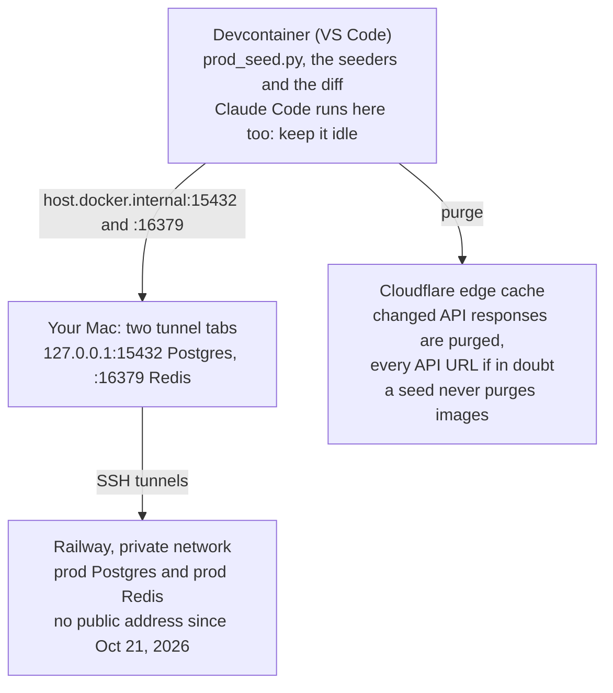

# Content seeding runbook

Last updated: Oct 27, 2026

## Quick reference

After editing the JSON, run these in order. Keep Claude Code idle from step 4 until step 9.

| # | Where | Command |
| --- | --- | --- |
| 1 | Devcontainer, `server/` | `uv run scripts/db/seed_collectibles.py`, then check dev |
| 2 | Devcontainer, `server/` | `uv run scripts/dev_workflow.py collectibles` |
| 3 | Mac, repo folder | Commit on a branch, push, merge the PR, then `git -C server/seed-data checkout main && git -C server/seed-data pull` |
| 4 | Mac, repo folder, tab 1 | `railway connect Postgres --tunnel-only -P 15432 --environment production 2>/dev/null` |
| 5 | Mac, repo folder, tab 2 | `railway connect Redis --tunnel-only -P 16379 --environment production 2>/dev/null` |
| 6 | Devcontainer, `server/` | `uv run scripts/db/diff_collectibles.py --prod` |
| 7 | Devcontainer, `server/` | `uv run scripts/prod_seed.py`, type `seed prod`, then check the site |
| 8 | Mac, both tunnel tabs | Ctrl+C |
| 9 | Mac, repo folder | `lsof -nP -iTCP:15432 -iTCP:16379 -sTCP:LISTEN`, which should print nothing |

For walkthroughs, use `seed_walkthroughs.py` in step 1 and `walkthroughs` in step 2. Still run step 6: it should list no changes.

## How it fits together

Content lives in the seed-data repo. You test a change on dev, then a prod seed sends it to Railway's private databases through two SSH tunnels opened on your Mac.



The devcontainer reaches prod only through your Mac's tunnels, while the purge goes straight to Cloudflare.

| Terminal | Folder | What you run there |
| --- | --- | --- |
| Mac terminal | the repo folder, `~/projects/personal/stellar-blade-guide-v2` | git pull and push, the Railway CLI, the two tunnels, the `lsof` check |
| Devcontainer terminal (VS Code) | `/workspaces/stellar-blade-guide/server` | every `uv run` command: the seeders, `dev_workflow.py`, the diff, `prod_seed.py` |

- **Two repos:** the main repo holds the code, and `server/seed-data` is its own git repo holding the content.
- **Prod is private:** Postgres and Redis have had no public address since Oct 21, 2026. Only the tunnels reach them.
- **A prod seed** checks both databases answer, asks you to type `seed prod`, seeds collectibles and walkthroughs, clears Redis, and purges the changed API responses from Cloudflare's cache, or every API URL if anything is in doubt.

## One-time setup

You need this once per machine. If a dry run already works (step 8 below, answering anything but `seed prod`), skip it.

1. Clone the main repo to `~/projects/personal/stellar-blade-guide-v2`, then clone the seed-data repo into its `server/seed-data` folder.
2. Open the repo folder in VS Code and choose Reopen in Container.
3. Install the Railway CLI on the Mac, then run `railway login`.
4. In the repo folder on the Mac, run `railway link` and pick the project's production environment.
5. Register your SSH key with Railway: `railway ssh keys add`. The key must open without a passphrase prompt, so either no passphrase or one stored in the macOS keychain.
6. `server/.env` isn't in git. Rebuild it from the variable list in `server/README.md`, then set the two prod lines, copying each password from its service's Variables tab in Railway:
    ```
    PROD_DATABASE_URL=postgresql://postgres:<postgres password>@host.docker.internal:15432/railway
    PROD_REDIS_URL=redis://default:<redis password>@host.docker.internal:16379
    ```
7. Keep `CLOUDFLARE_ZONE_ID` and `CLOUDFLARE_API_TOKEN` in `server/.env` too. The purge needs them.

Rules for those URLs:

- Keep the `postgresql://` scheme and the `default` user name.
- Write `@ / ? # %` in a password as `%40 %2F %3F %23 %25`.
- Never add `sslmode=`. It breaks the connection.
- Keep `RAILWAY_TOKEN`, `RAILWAY_PROJECT_ID` and `RAILWAY_ENVIRONMENT_ID` out of the shell. They override the link.

On a new machine, also copy what git doesn't hold from the old one:

- the image masters in `client/public/assets/images/`
- `CLAUDE.md` and `.claude/`, which hold Claude Code's conventions and deny list
- `server/scripts/db/diff_collectibles.py` and the `lint_collectibles.py` it imports, plus the lines in `.git/info/exclude` that keep both out of commits
- `server/scripts/cache/purge-manifest.json` and `server/scripts/images/prune-pending.json`, if they exist: the purges still owed and the R2 objects still to delete

The new devcontainer's database starts empty. Run `uv run scripts/db/seed_db.py`, then both seeders, before your first edit.

## Collectibles, step by step

A change goes edit, dev, git, then prod, and only the prod steps (the diff and the prod seed) need the tunnels. Each step says where to run it.

1. **Edit** `server/seed-data/collectibles/<level>/<location>.json`. Format rules, including paragraphs and lists, are in the seed-data README. New screenshots go in `client/public/assets/images/<Level>/<Location>/`, referenced as `/assets/images/…`.
2. **Seed dev** (devcontainer, `server/`): `uv run scripts/db/seed_collectibles.py`. The counts should match your edit, since `Updated` counts only changed rows. Check the result on the dev site at `localhost:3000`.
3. **Run the image pipeline** (devcontainer, `server/`): `uv run scripts/dev_workflow.py collectibles`. It makes WebP variants of new images, uploads them to R2, swaps the local paths for R2 URLs and seeds dev again. If any screenshot in `client/public/assets/images/` is no longer referenced, it first lists it and asks you to type `prune`. That deletes the screenshot for good, since git doesn't hold it, so read the list: any other answer stops the run, and you can fix the JSON and run it again. Then it asks for `yes` before the upload and again before the swap, and skips either when there's nothing to do. Any other answer stops the run there, before the dev seed.
4. **Commit** (Mac terminal, repo folder): commit the seed-data change on a branch, push it, merge the PR, then pull `main`:
    ```
    git -C server/seed-data checkout main && git -C server/seed-data pull
    ```
    The prod seed sends whatever is on disk, so always seed from a clean `main`.
5. **Check Claude Code is idle**, and start nothing in it until step 10.
6. **Open the tunnels** (Mac terminal, repo folder), one per tab, and leave both running:
    ```
    railway connect Postgres --tunnel-only -P 15432 --environment production 2>/dev/null
    railway connect Redis --tunnel-only -P 16379 --environment production 2>/dev/null
    ```
    The tabs stay quiet, because `2>/dev/null` hides the passwords the CLI prints.
7. **Diff against prod** (devcontainer, `server/`): `uv run scripts/db/diff_collectibles.py --prod`. It should list only your change, with ids and locations reading `none · none`. A new entry is the exception: the Ids line lists its id under `JSON only`, and the diff says to stop. Go on only if that lists exactly your new ids, the Ids line's `DB only` reads `none`, and the Locations line still reads `none · none`. An id under `DB only` would be deleted, with users' progress on it, so stop then.
8. **Seed prod** (devcontainer, `server/`): `uv run scripts/prod_seed.py`. It checks both tunnels answer, then asks you to type `seed prod`. `Updated` should match the diff, `Added` the number of new entries, and the purge should list only a few URLs. If earlier image work pruned screenshots, it then offers to delete their old R2 objects: type `y`, then `prune` when it asks, or anything else to keep them for later. It ends by telling you to close the tunnels: leave them open until step 10, since step 9 runs the diff again.
9. **Check the site**: look at the changed entries on stellarbladeguide.com, such as `/levels/<level>#collectible-<id>`. Running the diff again should show 0 differences.
10. **Close the tunnels**: Ctrl+C in both tabs, never closing the window. Then on the Mac, this should print nothing:
    ```
    lsof -nP -iTCP:15432 -iTCP:16379 -sTCP:LISTEN
    ```
    If it lists an `ssh`, run `kill <pid>`.

## Walkthroughs: what differs

Walkthroughs follow the same ten steps, with these differences:

- **Files:** `server/seed-data/walkthroughs/<category>/<n>-<name>.json`, where the DLC categories are `dlc/nier` and `dlc/nikke`. Screenshots go in `client/public/assets/images/Walkthroughs/<Mission_Type>/<Mission_Name>/`, except that each DLC keeps all its screenshots in one folder, `Walkthroughs/DLC/Nier_Automata/` or `Walkthroughs/DLC/Goddess_Of_Victory_Nikke/`.
- **Dev seed:** `uv run scripts/db/seed_walkthroughs.py`. Add `--check` to validate the files without writing anything.
- **Image pipeline:** `uv run scripts/dev_workflow.py walkthroughs`.
- **Still run the diff** (step 7): the prod seed reseeds collectibles from disk too, so it should list no changes. The prod seed's `↻ Updated` lines show which walkthroughs changed.
- **One prod seed covers both:** `prod_seed.py` always seeds collectibles and walkthroughs together. If both changed, do the dev steps for each, then seed prod once.

## Rules that keep prod safe

Two things carry the risk. While the tunnels are open, prod Postgres accepts superuser connections with no password from your Mac and every container on it. And the seed deletes every collectible and walkthrough missing from disk; a deleted collectible takes users' progress with it.

- **Open the tunnels only to seed,** and close them right after. Never leave them open through an editing session.
- **Keep Claude Code idle while they're open.** It runs in the devcontainer, so it could reach prod through them.
- **Close them with Ctrl+C only.** Closing the window leaves the tunnel's ssh running, still holding the door open.
- **Anything that reads prod needs the tunnels:** the diff, `search_eval.py --prod --timing`, `cache_stats.py --prod`, `purge_api_cache.py --singular-walkthroughs` and the migrations.
- **Seed from a clean seed-data `main`.** The prod seed sends everything on disk, not just your change.
- **Run prod seeds from the main checkout.** What's owed a purge (`server/scripts/cache/purge-manifest.json`) and the run lock live in the checkout, so a run from another copy misses both.
- **Never renumber ids.** Collectible ids carry users' progress and walkthrough ids carry comments. The seed-data README gives the id rules: a new collectible takes the next id after the highest, and each walkthrough category has its own range.
- **You run every seed, dev included.** Claude Code doesn't, by its own rule rather than a setting. Its deny list blocks edits to `prod_seed.py`: lift that rule for an approved change to the script, then put it back.
- **Seeding never purges images.** A changed image gets a new file name, since browsers keep an image for up to a year. `upload_r2.py --overwrite` is only for quality refreshes of the whole library: it re-uploads everything in `r2-staging/` and purges every URL it replaced. Never re-add a pruned image name with different bytes.

## When something goes wrong

Most failures stop the run before anything is written or purged, and the run prints the next command.

| What you see | Why | What to do |
| --- | --- | --- |
| `[STOPPED] Checking prod connections (exit 1)`, after 30 s of retries | A tunnel isn't open, or, if the lines above say `Name or service not known`, a host in `server/.env` is wrong | Open both tabs; on the Mac, `lsof` should show two `ssh` listeners. For `Name or service not known`, see that row below. |
| A tab is running, but nothing listens on its port | The tunnel failed quietly | Ctrl+C it and rerun without `2>/dev/null` to see the error. That prints the password, so don't share the output. |
| `✗ Prod Postgres didn't answer` (or Redis) from the diff or another `--prod` script, after about 10 s | That tunnel isn't open, or, with `Name or service not known` above it, its host is wrong | Run the `railway connect` line it prints in a Mac tab, then rerun; for `Name or service not known`, see that row below. A `--prod` migration says `ConnectionRefusedError` instead. |
| `✗ Prod Redis can't be used as set up` (or Postgres), or `[STOPPED] Checking prod connections (exit 3)`, usually with no wait | The lines above it say why: usually an old Redis password, or a second `@` in a URL | See the next two rows. The tunnel commands `prod_seed.py` prints after it won't help, unless a line above also says `no answer in 30 s`: then that tunnel isn't open either. |
| `the URL has more than one @`, or `Name or service not known` for Postgres | A URL in `server/.env` has a second `@`, or `PROD_DATABASE_URL` has a stray character before the host | Keep exactly one `@`, right before the host. Write an `@` in a password as `%40`. |
| Redis refuses the password | `server/.env` has an old Redis password | Copy it from the Redis service's Variables tab in Railway. |
| The diff lists more than your change | Something else on disk differs from prod | Check that seed-data is on a clean, pulled `main`. |
| A seed stops with entries it can't seed | A data error, such as an unknown level or type, or a missing field | Fix the listed entries and rerun. That seeder wrote nothing, but if it was the walkthrough step, the collectibles are already in prod and owed a purge: the rerun makes it, or `uv run scripts/prod_seed.py --purge-only` makes it first. |
| `[FAILED] <step>` with a next command | A seeder, the cache clear or the purge failed | Run what it says: usually a rerun, or `uv run scripts/prod_seed.py --purge-only`. |
| `[FAILED] Checking walkthrough files` with `still marked [VERIFY]` | A walkthrough still has a `[VERIFY]` marker. Dev seeds accept it; prod doesn't | Confirm or remove the marker, commit, then rerun. `uv run scripts/db/seed_walkthroughs.py --check` catches it before you commit. |
| `[INTERRUPTED] during <step>` | You pressed Ctrl+C mid-run, or the terminal closed | Run the command it prints: the seed again, or `--purge-only` if the seeding had finished. |
| `[CRASHED] prod_seed.py stopped on an error of its own` | A fault in the script itself, not in a step | The run's log in `server/logs/seed/` has the traceback, and the lines before it show what ran. Run it again: its header says what's still owed a purge. |
| `[FAILED] Checking collectible files` (or walkthrough files) with `still point at the local masters folder` | The URL swap never reached those entries, and their images would break on prod | Run the image pipeline (step 3: `uv run scripts/dev_workflow.py collectibles`, or `walkthroughs`), commit, then rerun. Nothing was written. `uv run scripts/db/seed_collectibles.py --check` (or `seed_walkthroughs.py --check`) catches it before you commit. |
| `Another prod seed is running.` | A run is already going | Wait for it to finish, and leave the tunnels open: that run is using them. |
| Old text after a seed | Browsers keep a page's data for up to an hour and may show it once more while fetching the new copy; search results are kept for up to an hour | Reload. If it's still old, wait an hour and reload twice. A private window skips your own browser's copy. |
| Old text after more than an hour | A URL the purge missed stays at the edge for 30 days | With Claude Code idle, open both tunnels, run `uv run scripts/prod_seed.py --purge-only --purge-all` and type `seed prod`. It purges every API URL without seeding. Then close the tunnels. |

Through the tunnel, Postgres doesn't check its password, so a stale one in `server/.env` goes unnoticed.

## Where to look for more

- `server/seed-data/README.md`: the content format, including paragraphs, lists and the id rules.
- `server/scripts/images/PIPELINE.md`: the image pipeline and its Seeding prod section, in more detail. If the two docs disagree, the scripts decide.
- `server/logs/seed/`: one log per prod run, named by its run id.
- `server/logs/prune/`: one log per `prune_bucket.py` run that has something to prune, with every key it deleted. A prune that `prod_seed.py` started has the seed's run id in its name.
- `CLAUDE.md` in the repo root (local, not committed): the conventions Claude Code follows.

This reflects the pipeline as of late Oct 2026, including the seed reliability update.